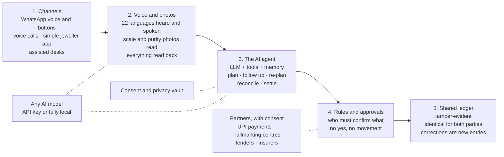

# Saakshi: gold never moves without two confirmations

**Tech4Bharat 2026 (GAVS Hackathon) · Theme 2 Jeweltech · Problem statement 2.2 · Agentic AI · Team FiatLux**
> *"Gold given to karigars for job-work is tracked on trust, and disputes follow."* (problem statement 2.2)

Saakshi (साक्षी, "witness") is a **two-key gold record**, with an AI agent that runs every job-work order from issue to payment.
- **The jeweller** photographs the scale and speaks.
- **The karigar** hears a spoken receipt on WhatsApp **in any of India's 22 scheduled languages** and says "haan".
- **Both** keep the same receipt.
- **Returns** are checked fairly, settlements need both sides' approval, and a karigar's clean record becomes a passport they own.

> **Status: Round 1 (idea and design).** This repository holds our research, the idea, the [high-level design](docs/high-level-design.md), the [low-level design](docs/low-level-design.md) and the plan. We build the prototype from 23 Nov to 15 Dec 2026.

---

## 1. The problem in 60 seconds
- Every day, jewellers hand gold to karigars (artisan goldsmiths) to make ornaments.
  - A karigar handles **300–400 g a month**, which is **₹40–53 lakh of 22K gold** at today's prices.
  - Even formal firms outsource **30–50%** of their work this way ([IIMA/XLRI, 2023](docs/problem-and-landscape.md#sources)).
- The record of all this is **one notebook, written and kept by the jeweller.**
- **Honest people still fight.** In our [worked example](docs/problem-and-landscape.md#a-worked-example-why-honest-people-still-fight), the return looks **18 mg "short"**. Normal measurement error is about **±105 mg**, so nobody can tell whether anything is missing at all.
  - A purity reading just 4 parts per thousand higher turns the same return into **165 mg "extra"**.
- **Wastage is pay.** The allowance is part of the karigar's earnings, but its basis (issued or returned weight) is often never written down.
- **Nobody follows up.** Deadlines are chased by phone, and karigars wait weeks for month-end cash.
- **When trust breaks, losses are large.**
  - Reported absconding cases in Mumbai have run from **₹98 lakh to ₹2.66 crore** each.
  - In Bengaluru, goldsmiths have disappeared with more than a kilogram.
- **Why now:**
  - each gram is worth **more than 2×** what it was in 2023;
  - purity shortfalls can now start cancellation of a jeweller's BIS registration;
  - WhatsApp voice notes and UPI now reach migrant karigars, and voice technology now works in all 22 scheduled languages.

**Field validation (12–14 Nov 2026):** we are meeting about **10 jewellers and 10 karigars** in Bengaluru, plus a hallmarking centre, a testing shop and an association, to test ten hypotheses with pass marks fixed in advance. See the [field validation plan](docs/field-validation-plan.md); results will be added there.

## 2. The gap we are closing

| Today | Good at | Missing |
|---|---|---|
| Paper notebook | Free, flexible, universal | One copy, held by one side, easy to alter; no fine-gold maths; no reminders |
| Jewellery software and ERPs | Stock, billing, GST | Built for the jeweller only: **no karigar copy or confirmation**; typed in English or Hindi; every difference treated as real; passive records, not agents |
| Khata apps | Simple money reminders | **Money only**: no grams, purity or wastage |
| Association guarantees, police verification | Work inside one community | Slow, intrusive and local; do nothing for honest disputes |
| Welfare IDs and schemes | Identity, insurance, loans | Prove who someone is, **not the work they delivered** |

**A record one side controls can never be the trail both sides accept.** No one has built a neutral witness with all four of these:
- both parties hold it;
- the karigar can use it by voice in their own language;
- it understands measurement error;
- it **runs** the order instead of just storing it.

Full landscape: [docs/problem-and-landscape.md](docs/problem-and-landscape.md).

## 3. The idea: Saakshi in one minute

| # | Who | What happens |
|---|---|---|
| 1 | Jeweller | Photographs the scale and says, in Kannada, *"ರಫೀಕ್‌ಗೆ ಎರಡು ಬಳೆ, 22 ಕ್ಯಾರೆಟ್, ಡಿಸೆಂಬರ್ 12ರೊಳಗೆ"* ("two bangles for Rafiq, 22 carat, by 12 December") |
| 2 | Saakshi | Reads the scale photo (**48.250 g**) and reads the details back |
| 3 | Jeweller | Says "haudu" (yes) or taps Confirm: **the first key** |
| 4 | Saakshi | Plans back from 12 December and sends Rafiq a spoken receipt on WhatsApp **in Marathi**: *"रफीकभाऊ, तुम्हाला ४८.२५० ग्रॅम सोने मिळाले आहे…"* ("Rafiq bhau, you have received 48.250 g of gold…") |
| 5 | Karigar | Says **"ho"** (yes) or taps a button: **the second key** |
| 6 | Both | See **the same receipt with the same short code**. The gold has moved with two confirmations. |

The karigar needs no new app, no typing and no English. The same flow, drawn through every part of the system, is in the [high-level design §5.1](docs/high-level-design.md#51-issue-with-two-keys-the-core-flow).

## 4. How the agent works
Saakshi is not a register that waits to be written in. **An AI agent owns each order from issue to payment.**

| | What the agent does |
|---|---|
| **Plan** | Works back from the wedding date to set milestones. Suggests the right karigar from skill, current load, on-time record and gold limit. |
| **Act** | Issues receipts and sends voice check-ins. Prepares returns, statements and UPI payment links. |
| **Remember** | Keeps each order's full history, plus each person's language, preferences and past agreements. |
| **Recover** | No reply: a reminder, then a voice call, then a task for a nearby JanAI Café or Saakshi point. Work slipping: a new plan, approved by the jeweller before the customer is updated. |
| **Ask** | Never moves gold or money, changes terms, contacts a customer or shares a record on its own. |

**Who must say yes:**
- **Both parties:** every issue, return, change of terms, settlement and dispute resolution.
- **The jeweller:** customer updates.
- **The karigar:** any sharing of their record.

**Under the hood: an agentic AI workflow.**
- A large language model (LLM) runs in a ReAct-style loop. It reads the case, reasons, calls a tool, sees the result and repeats until the task is done or a person must decide.
  - Its tools include sending a check-in, placing a call, and proposing a plan, a return or a settlement.
- Saakshi's case engine is the harness around the LLM:
  - tools with strict schemas;
  - memory of every case;
  - durable timers;
  - a policy gate that blocks any action without the right approvals.
- The LLM handles language and judgement. Weights, verdicts, balances and payments are always computed by deterministic code.
- Routine steps, such as a button tap or a clear "haan", never need the LLM at all.

Details: [high-level design §4.4](docs/high-level-design.md#44-the-agent-loop-agentic-ai).

## 5. Fairness by design
Every return is checked in **pure (fine) gold**, allowing for the normal error of scales and purity machines. The result is one of three plain-language verdicts.

| Verdict | Meaning |
|---|---|
| ✅ Matches the agreement | Settle as agreed |
| 🟡 Within normal measurement range | **Nobody is accused.** A rule both sides agreed in advance decides who carries the small difference. |
| 🔴 Needs a re-check | Neutral re-weigh or re-test at a Saakshi point, with both present |

- **Wastage is pay.** Terms are co-signed and versioned, and never tightened silently.
- **Same gap for every karigar?** Then the scale or machine is flagged, not the people.
- **No blacklists.** Disputes are resolved between the two parties, with evidence both can see.
- **"Mera hisab".** Any karigar can ask at any time and hear their balance with every jeweller.

The maths, with worked test cases: [low-level design §5](docs/low-level-design.md#5-reconciliation-the-fairness-maths).

## 6. Built for Bharat
- **All 22 scheduled languages + English.** Each person speaks and listens in their own language.
  - Assamese, Bengali, Bodo, Dogri, Gujarati, Hindi, Kannada, Kashmiri, Konkani, Maithili, Malayalam, Manipuri, Marathi, Nepali, Odia, Punjabi, Sanskrit, Santali, Sindhi, Tamil, Telugu, Urdu, and English.
  - Native speakers review Hindi, Bengali, Kannada, Marathi, Tamil and English first; the rest follow as pilots grow.
- **Voice first, buttons as a fallback,** for people with limited literacy and 14-hour working days.
- **Entry-level Android and patchy networks.** The jeweller's app works offline.
- **Assisted mode.** JanAI Café operators and Saakshi points (testing shops, hallmarking centres, association desks) can onboard people and confirm on their behalf, with consent.
- **Any AI model, run anywhere.** The LLM, speech and photo-reading models sit behind one model adapter. Each can be one of:
  - a proprietary model used with an API key;
  - an India-built model;
  - an open-weight model running locally on a shop's or an association's own computer, when cost or privacy matters.

  This means:
  - no lock-in, lower cost, and the data can stay local;
  - every model set-up must pass the same 32 test scenarios before it is used;
  - every rule that touches gold or money is fixed in Saakshi's own code, so no model can change a weight, a verdict or a payment.

## 7. Architecture

Each layer can be replaced without touching the others. The agent can propose, but **only the rules and both parties' confirmations can move gold or money.**

**For technical readers:**
- [High-level design](docs/high-level-design.md): principles, actors, the five layers and their components, the agent loop and its tools, every key flow with sequence and state diagrams, data overview, deployment, non-functional targets, failure handling, and how the design meets each requirement of statement 2.2.
- [Low-level design](docs/low-level-design.md): modules, every entity and invariant, ledger posting rules and the hash chain, the reconciliation maths with test vectors, planner and settlement formulas, state machines and timers, the agent loop, tool contracts and model routing, voice, reply and photo pipelines, WhatsApp templates, endpoints and events, security, and the 32 test scenarios.

## 8. What is new
1. **Two-key receipts by voice:** the first gold record that the karigar holds and confirms in their own language, without typing.
2. **Measurement-aware fairness:** tells normal instrument error apart from real loss, so honest people are never accused.
3. **An AI agent, not a register:** an LLM in a tool-using loop that plans, follows up, re-plans and settles, and asks a human at every decision that matters.
4. **Every Indian language:** the same spoken receipt in all 22 scheduled languages.
5. **Any AI model, run anywhere:** proprietary or open-weight models, in the cloud or fully offline on a shop's own computer.
6. **Trust that travels:** a record of work delivered that the karigar owns and shares only with consent.

## 9. Who benefits

| Party | First week | Long term |
|---|---|---|
| Jeweller | Proof of every gram given out; deadlines tracked automatically | Fewer disputes and losses; gold limits; a hallmark-to-job trail that protects the BIS registration; karigars who stay |
| Karigar | Their own copy of every issue and return; "mera hisab" at any time | Fair counting, payment per job, a passport to bigger orders and credit |
| Customer | On-time delivery; updates the jeweller has approved | Traceable purity |
| Lender, insurer (later) | — | Consented performance data on a workforce they could not underwrite before |
| JanAI Café, Saakshi point | Fees per assisted service | A recurring service line |

## 10. Business model and market
- **Jewellers pay; karigars are always free.**
- **Plans** (hypotheses we are testing in the field):

| Plan | Price | For |
|---|---|---|
| Free | ₹0 | Up to 3 karigars |
| Pro | ₹999 a month | Up to 15 karigars: agent follow-ups, settlements, statements |
| Business | ₹1,999 a month | Unlimited karigars and staff, purity trail, insurer-ready register |
| Manufacturer | ₹100–150 per karigar a month | Large karigar networks |

- **Return on investment (illustrative):** take a jeweller who issues 2 kg a month and cuts unexplained variance by 0.25%. They save **about 5 g, roughly ₹66,000 a month**, against a ₹999 subscription.
- **Market:**
  - about **2.37 lakh** BIS-registered jewellers;
  - India's 2025 gold jewellery demand was worth **₹4.54 lakh crore**;
  - Bengali karigars alone number an estimated 6.5 lakh.
- **Later revenue,** by following the money:
  - consented karigar passports for lenders (including PM Vishwakarma lenders);
  - custody registers for jewellers' block insurance;
  - a wedding-season marketplace of verified karigars;
  - anonymised loss benchmarks.

## 11. Go-to-market, scale and jobs
- **Beachhead:** Bengaluru's jewellery cluster (Avenue Road, Chickpet, Nagarthpet), where Kannada-, Bengali- and Hindi-speaking jewellers and karigars work side by side.
- **Entry:**
  - through jewellers' and karigars' associations;
  - testing shops and hallmarking centres become **Saakshi points** for neutral re-weighs and assisted onboarding.
- **Network effect:** every karigar works for several jewellers and can invite each of them.
- **No-risk start:** two-week shadow pilots run alongside the notebook, then a value report (grams confirmed, on-time %, days to pay).
- **Then cluster by cluster:** Chennai, Coimbatore, Thrissur, Mumbai, Kolkata.
- **Jobs:**
  - **Saakshi Mitras:** local youth who onboard and support jewellers, about one per 100 jewellers, paid per active jeweller.
  - **JanAI Café and Saakshi-point operators:** paid per assisted service, including cafés in karigars' home districts.
  - **Karigars who grow:** faster pay, direct work and credit turn them into workshop owners who hire apprentices.

## 12. Consent, privacy and safety
- **Consent:** asked by voice, purpose by purpose, in the person's own language; it can be withdrawn.
- **Minimal data:** no locations and no tracking. Records stay private between the two parties unless both choose otherwise.
- **The karigar's record:** shared only with their explicit consent, and only for as long as they allow.
- **Labelled simulations:** anything simulated in the prototype (payouts, hallmarking results, lender offers) is clearly labelled.
- **Data protection:** designed for India's Digital Personal Data Protection rules from day one.

## 13. How we will prove it works
- **Confirmations:** 100% of gold movements are confirmed by both parties before they count, in every test.
- **Fairness:** zero accusations across our test cases for differences within normal measurement range.
- **Accuracy:** published on real scale photos and voice notes collected in the market.
- **Agent scenarios:** 32 real-world situations scripted and tested with every approval respected, including late work, no reply, a wrong reading, a dispute and a lost network.
- **Live pilot before the finale:** 3 jewellers, 10 karigars and 100+ co-signed movements, measuring days to pay and on-time delivery.

## 14. Plan

| When | What |
|---|---|
| 12–14 Nov | Field validation: jewellers, karigars, hallmarking centres, testing shops |
| 15 Nov | Round-1 idea submission |
| 16–22 Nov | Groundwork: receipts in every language, first end-to-end flow |
| 23 Nov–13 Dec | Build in three sprints: **(1) two-key receipts in every language → (2) the agent: planning, follow-ups, settlement, disputes → (3) trust that travels: hallmark links, gold limits, karigar passport** |
| 14–15 Dec | Prototype submission with a demo video |
| 16–26 Dec | Live pilot in Bengaluru |
| 27 Dec | Finale demo: brass props on a real scale, a Kannada-speaking jeweller and a Marathi-speaking karigar, live |
| From Jan 2027 | Paid pilots, then the next cluster |

## Documents in this repository
- [High-level design](docs/high-level-design.md): what we are building and how the parts connect.
- [Low-level design](docs/low-level-design.md): the data, maths, state machines and interfaces we build to.
- [Problem and landscape](docs/problem-and-landscape.md): the statement decoded; how job work really works (with a worked example); the rules (GST, BIS hallmarking, DPDP); root causes; market size; stakeholders; existing solutions and their gaps; all sources.
- [Field kit](docs/field-kit.md): our interview guides for jewellers, karigars, hallmarking centres and testing shops; consent cards in five languages; the hypotheses we set out to test.
- [Field validation plan](docs/field-validation-plan.md): who we are meeting on 12–14 Nov, the ten hypotheses and their pass marks; results are added after the visits.
- [Pitch deck (PDF)](deck/Saakshi_Tech4Bharat_PS2.2.pdf)

## Team
**FiatLux**: Shubham Jadhav, IIT Madras (founder: product, field research, design and build).
