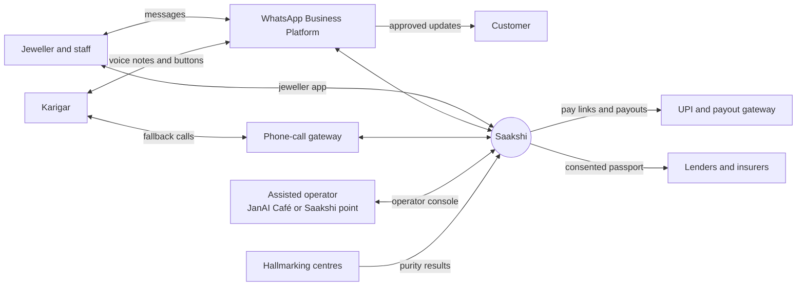
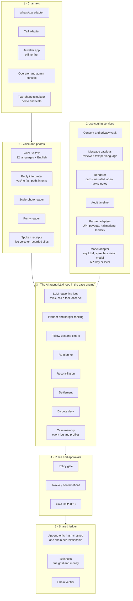
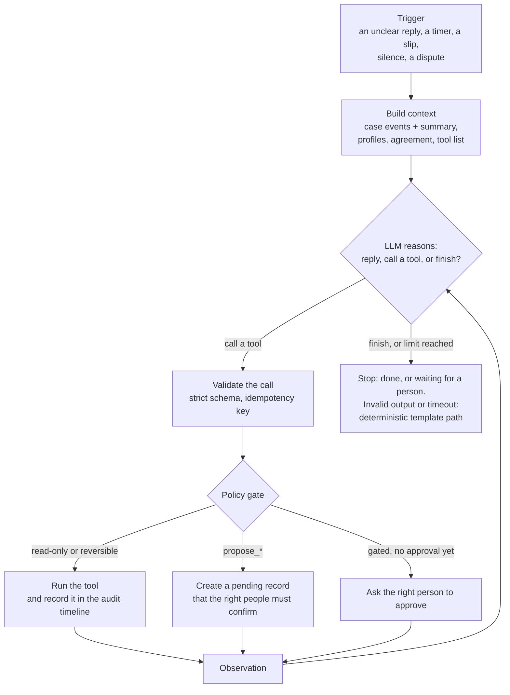
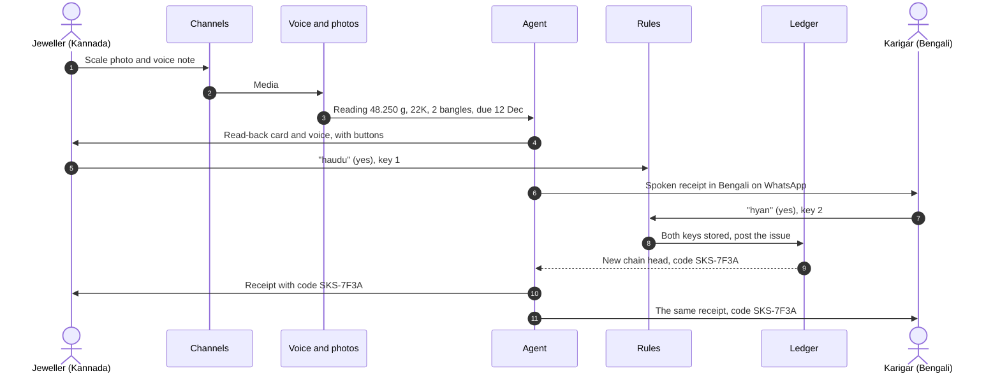
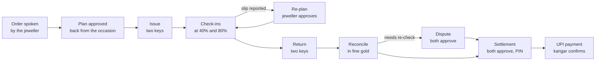
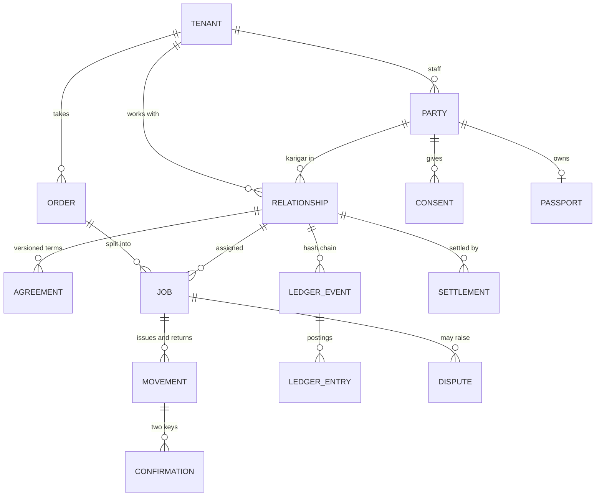
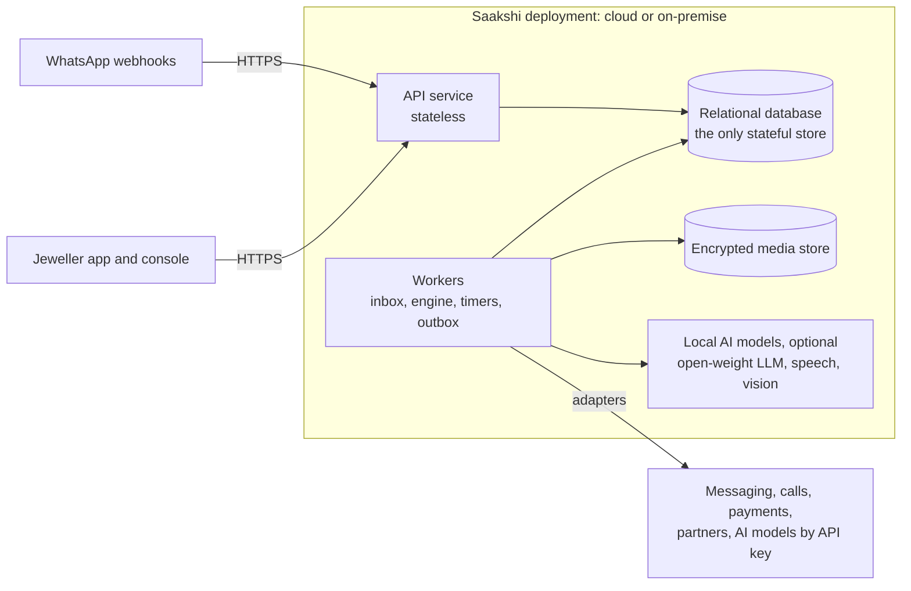

# Saakshi: high-level design

*Version 1, 11 Nov 2026 · Team FiatLux · Status: the design we build in the prototype round (23 Nov–15 Dec 2026).*
*Companion documents: [low-level design](low-level-design.md) · [problem and landscape](problem-and-landscape.md) · [field validation plan](field-validation-plan.md).*

**Priorities used below:** **P0** ships in the prototype · **P1** should ship in the prototype · **P2** later.

---

## 1. What the system does
Saakshi is a neutral record of gold job work that **both** the jeweller and the karigar hold, plus an AI agent that runs each order from issue to payment.

- **Two keys.** Every gold movement (an issue, a return of pieces, a return of scrap, a correction) is read from an instrument, read back, and confirmed by **both** parties before it counts.
- **Both sides hold it.** Each party sees and hears the same record in their own language, by voice or buttons on WhatsApp. The karigar needs no new app.
- **Fair maths.** Returns are reconciled in fine (pure) gold, allowing for the normal error of scales and purity machines.
- **An AI agent, not a register.** An LLM in a tool-using loop (§4.4) plans each order back from the occasion date, follows up, re-plans, reconciles, prepares the settlement and recovers from silence or failure. It always stays inside the approval rules.
- **Two-party money.** A settlement needs both parties' approval; a payment also needs the jeweller's PIN.
- **Trust that travels (P1).** A karigar's record becomes a signed, consented passport for new jewellers, lenders and insurers.

## 2. Design principles (enforced in code and tested on every build)

| # | Principle | How the design enforces it |
|---|---|---|
| 1 | **No movement counts without both keys** | A movement stays *pending* for both sides until confirmations from both parties are stored. Only then is it posted to the ledger. |
| 2 | **Nothing is edited** | The ledger is append-only and hash-chained, one chain per jeweller–karigar relationship. A correction is a new entry that both parties confirm. |
| 3 | **Weights come from instruments** | A weight is read from a scale photo (later from a direct scale connection), never from speech alone. Every number is read back. |
| 4 | **The agent proposes, people approve, code enforces** | Every action that moves gold or money, changes terms, contacts a customer or shares a record runs only through a policy gate that checks stored approvals. |
| 5 | **One calculation for both sides** | All maths is deterministic and uses integers: milligrams (mg), parts per million (ppm) and paise. |
| 6 | **Messages are data, not commands** | Nothing anyone says or sends can change a record, except as a proposal that the other party confirms. |
| 7 | **No public scores, no blacklists** | Dispute outcomes stay between the two parties. |
| 8 | **Replaceable adapters, any AI model** | Messaging, calls, payments, partners and every AI model (the LLM, speech, and photo reading) sit behind adapters. A provider or model is changed by configuration: a proprietary model with an API key, or an open-weight model running locally. The whole system can run on-premise. |
| 9 | **Mocks are labelled** | Anything simulated says so in the app, in messages and in demos. |
| 10 | **The LLM never computes or moves value** | The LLM reads language and proposes. Weights come from instruments; verdicts, balances and payments come from deterministic code; posting needs both keys. |

## 3. Actors and external systems

| Actor or system | Uses Saakshi through | Main needs |
|---|---|---|
| Jeweller (owner) and counter staff | Jeweller app (works offline) and WhatsApp | Capture issues and returns in seconds; see the gold out with each karigar; approve plans, settlements and payments |
| Karigar and head karigar | WhatsApp voice notes and buttons; a phone call as the fallback | Hear and confirm every movement in their language; ask "mera hisab" (my balance) at any time; get paid on time |
| Assisted operator (JanAI Café, or a Saakshi point: testing shop, hallmarking centre, association desk) | Operator console | Onboard people; play a receipt and record an assisted confirmation with a one-time code |
| Customer | WhatsApp updates | On-time delivery; only messages the jeweller approved |
| WhatsApp Business Platform | Messaging adapter | Templates, voice notes, buttons, delivery receipts |
| Phone-call gateway (P1; simulated in P0) | Call adapter | Outbound calls with a spoken or keypad reply |
| UPI and a payout gateway | Payment adapter | UPI intent links (real); payouts (sandbox in the prototype) |
| Hallmarking centres (P1; mock in the prototype) | Partner adapter | Purity results linked back to the job and the karigar |
| Lenders and insurers (P1; mock in the prototype) | Passport verification page | Consented, verifiable work records |

## 4. Architecture

### 4.1 Five layers
Requests flow down through the layers. Each layer can be replaced without touching the others. **Only layer 4 (rules) and both parties' confirmations can put anything into layer 5 (the ledger).**

### 4.2 Component responsibilities

| Component | Layer | Responsibility | Priority |
|---|---|---|---|
| WhatsApp adapter | 1 | Receives messages (signature-checked, de-duplicated); sends templates, buttons, voice notes and media | P0 |
| Call adapter | 1 | Outbound call that asks a spoken question and records a spoken or keypad reply | P1 (simulated in P0) |
| Jeweller app | 1 | Capture (camera with a guide box, voice note), karigars, jobs, approvals, settlement; works offline on entry-level Android | P0 |
| Operator and admin console | 1 | Case timeline, chain verifier, operator tasks, assisted confirmation, language gallery, demo clock | P0 |
| Two-phone simulator | 1 | A jeweller phone and a karigar phone in the browser, on exactly the same engine path; the demo fallback and the test channel | P0 |
| Voice-to-text | 2 | A speech-recognition model turns a voice note into text in the speaker's language, with language detection and an English gloss | P0 |
| Reply interpreter | 2 | Recognises yes and no in every language instantly from word lists; an LLM with a strict output schema turns other replies into an intent and details; asks back when unsure | P0 |
| Scale-photo reader | 2 | A vision model reads the weight from a photo of the scale display; rule checks cover unit, stability, tare and reused photos | P0 |
| Purity reader | 2 | Reads fineness from a photo of the purity-machine screen or printout, or takes a typed or spoken value | P0 |
| Spoken receipts | 2 | Speaks every receipt and question in the person's language | P0 |
| LLM reasoning loop | 3 | Handles judgement and exceptions: ambiguous replies, re-plan options, dispute summaries, odd situations. Calls tools in a loop; every call is schema-checked and gated (§4.4). | P0 |
| Planner and ranking | 3 | Plans back from the occasion date; ranks karigars by skill, load, on-time record and gold-limit headroom | P0 |
| Follow-ups and timers | 3 | Check-ins, reminders, calls and escalations on durable timers, with quiet hours | P0 |
| Re-planner | 3 | Proposes options when work slips (extend, split, reassign, speed up hallmarking, inform the customer); every option is checked against dates and capacity | P0 |
| Reconciliation | 3 | Fine-gold balance, measurement uncertainty, verdict, noise rule; drift and instrument attribution | P0 (drift P1) |
| Settlement | 3 | Statement for both parties; payment only after both approve and the jeweller enters a PIN | P0 |
| Dispute desk | 3 | Captures both claims and the evidence, prepares a neutral summary and options, records the resolution both approve | P0 |
| Case memory | 3 | The event log for each job is the memory; profiles hold each person's language, skills, load and preferences | P0 |
| Policy gate | 4 | Allows a gated action only when the right approvals are stored | P0 |
| Two-key confirmations | 4 | Collects and binds both parties' confirmations to the exact record they saw | P0 |
| Gold limits | 4 | Suggested limit per karigar; blocks or splits an issue that exceeds it | P1 |
| Shared ledger | 5 | Posts double-entry movements in fine milligrams and paise; extends the hash chain; keeps balances | P0 |
| Chain verifier | 5 | Recomputes a chain from the start and compares it with the codes each party received | P0 |
| Consent and privacy vault | × | Encrypts personal data per person; records consent per purpose; erases on request | P0 |
| Message catalogs | × | The only source of user-facing text, per language, with review status | P0 |
| Renderer | × | Receipt cards in every Indian script, narrated video for templates, voice notes | P0 |
| Audit timeline | × | Records every event, decision, approval, timer and outside call | P0 |
| Partner adapters | × | UPI links (real), payouts (sandbox), hallmarking and lender (mock in the prototype) | P0 / P1 |
| Model adapter | × | One interface over the LLM, speech and vision models. Set-ups for API-key, India-built and local open-weight models; routes each task to a configured model. | P0 |

### 4.3 How one message moves through the system

| # | Step | Where | Time budget |
|---|---|---|---|
| 1 | Webhook received; signature checked; stored in the inbox, de-duplicated on the provider's message ID; acknowledged | API | < 300 ms |
| 2 | The sender is resolved (by a keyed hash of the phone number) and the message becomes a domain event | Worker | < 200 ms |
| 3 | Media is downloaded; voice-to-text or photo reading runs | Worker | 1.5–4 s |
| 4 | The yes/no fast path, or the reply interpreter | Worker | 0–3 s |
| 5 | The case handler decides the transition. State, ledger entries, timers and outgoing messages are written **in one transaction** | Worker | < 100 ms |
| 6 | The outbox renders the card, voice and video (cached when possible), uploads the media and sends | Worker | 1–4 s |

**Targets (median):** karigar says "haan" → both receipts in **≤ 8 s**; jeweller's photo and voice note → read-back in **≤ 15 s**.

Routine replies (a button tap, a clear "haan") never reach the LLM. Exceptions go to the agent loop (§4.4): an ambiguous reply, a slip, silence or a dispute. Its proposals pass through the same handler and policy gate as everything else.

### 4.4 The agent loop (agentic AI)
**The agent is an LLM inside a harness.** The LLM runs a ReAct-style loop:
1. It reads the case.
2. It reasons about what to do next.
3. It calls one tool.
4. It observes the result, and repeats.

The loop ends when the task is done, when a person must decide, or when a step or time limit is reached. **The harness is Saakshi's case engine**, which provides:
- the tools, each with a strict schema;
- the memory, which is the event log of the case plus profiles;
- durable timers that wake the agent;
- the policy gate, which runs every gated action only with stored approvals.

**Where the LLM is used, and where it isn't**

| Situation | Handled by | LLM? |
|---|---|---|
| A button tap (Haan, Nahi, Hisab) or a clear yes/no word | Deterministic flow | No |
| A templated outbound message | Template and speech | No |
| A scale or purity photo | Vision model with structured output, then rule checks and read-back | Yes (extraction) |
| A free-form voice note or text | Speech-to-text, then the LLM extracts intent and details | Yes (extraction) |
| An ambiguous reply ("hmm, kal dekhte hain") | A clarifying question or options | Yes |
| A slip, silence or a capacity clash | The agent loop proposes re-plan options with their time and gold impact | Yes (reasoning) |
| A dispute summary or evidence pack | The agent loop drafts neutral wording; the jeweller approves | Yes (reasoning) |
| Every number, verdict and balance | Reconciliation and ledger code | **Never** |

**Tools the agent can call**

| Class | Tools | Rule |
|---|---|---|
| Read | `get_case`, `get_profile`, `get_balances`, `get_agreement`, `list_open_jobs`, `compute_reconciliation`, `suggest_assignment`, `read_scale_photo` | Free to call; the maths and ranking inside them are deterministic |
| Talk | `send_template_message`, `place_call`, `schedule_checkin`, `request_retake` | Approved templates only; logged; reversible |
| Propose | `propose_issue`, `propose_return`, `propose_plan`, `propose_replan`, `propose_settlement`, `propose_limit_change`, `open_dispute`, `propose_resolution` | Create a **pending** record that the counterparty and/or the jeweller must confirm |
| Gated | `notify_customer`, `initiate_payout`, `share_passport`, `submit_hallmark_request` | Run only with stored approvals: the jeweller's tap, both parties plus a PIN for payouts, the karigar's spoken consent for sharing |

**The model never writes to the ledger.** It can only propose; people confirm; the ledger code appends.

**How much the agent does on its own**
- **Alone:** reminders, check-ins, calls, retake requests, clarifying questions, re-plan options, drafts, explanations of a verdict in each person's language.
- **Never alone:** moving gold or money, changing terms, contacting a customer, sharing a record. These always wait for the right person's yes.

**Any AI model**
- **One model adapter** sits in front of every AI task: the LLM, speech-to-text, text-to-speech and photo reading. A model set-up is chosen in configuration, not code, and can be any of:
  - a proprietary model with an API key;
  - an India-built model;
  - an open-weight model running locally on the shop's or the association's computer, when cost or privacy matters.
- **Routing by task:**
  - a small, fast model is enough for yes/no and extraction;
  - a stronger model handles re-planning and dispute summaries;
  - each route can use a different set-up.
- **Measured, not assumed:** every model set-up must pass the same 32 scenarios (low-level design §14) before it is switched on, including 100% approval-gate compliance. A cheaper or local model can misread a reply, but read-back and confirmation catch that. It can never change a weight, a verdict or a payment.

**Guardrails**
- **Messages are data, not instructions.** Nothing a party says can change a record except through a `propose_*` tool and the counterparty's confirmation. Prompt-injection cases are part of the test scenarios.
- **Strict schemas, checked before every tool runs;** idempotency keys on every write.
- **Neutral wording.** A message that describes the other party, such as a dispute summary, needs the jeweller's approval and passes a neutral-wording check.
- **Fallbacks.** A refusal, timeout or invalid output gets one retry, then the deterministic template path with buttons. A person in the console sees it.

## 5. Key flows

### 5.1 Issue with two keys (the core flow)

- **If the karigar says "nahi" (no),** the movement becomes *disputed* and the dispute desk opens (§5.6).
- **If the karigar is silent,** a reminder goes after 2 h, a call after 3 h, and an operator task plus a jeweller alert after 24 h.
- **If the photo can't be read,** the jeweller is asked to retake it with a tip (glare, angle, tare). Keypad entry, typed twice, is the last resort.

### 5.2 Order life cycle

### 5.3 Follow-ups and re-planning
- **Check-ins** go to the karigar at 40% and 80% of the time between issue and return due, with "On track", "Delayed" and "Call me" buttons, or a voice reply ("do din aur": two more days).
- **Due and overdue.** A reminder goes one day before the return is due. Two hours after it is overdue, the job is marked *at risk* and the re-planner proposes options.
- **Options are checked before anyone sees them:** every date, capacity and buffer must hold. If none survives, the safe default is "extend" or "ask the jeweller".
- **The jeweller approves** every plan and re-plan, and every message to a customer.
- **Quiet hours** (21:30–08:30 by default, set per person) hold messages until morning.

### 5.4 Return and reconciliation
1. The jeweller photographs the finished pieces and the scrap on the scale, and the purity reading (XRF screen or printout).
2. Each return is read back and confirmed by both parties, exactly like an issue.
3. Reconciliation computes, in fine gold: issued, the agreed allowance, required, returned, the balance, and the measurement uncertainty of all the readings together.
4. The verdict goes to both parties in their own languages:

| Verdict | Rule | What happens |
|---|---|---|
| ✅ Matches the agreement | Balance ≥ 0 | Settle as agreed |
| 🟡 Within normal measurement range | Shortfall within 2.5 × the combined uncertainty | **Nobody is accused.** The noise rule both signed decides who carries the difference |
| 🔴 Needs a re-check | Shortfall beyond that | A dispute opens; settlement is blocked; a neutral re-weigh or re-test is suggested **only** when it can actually settle the question |

The full maths, with worked test vectors, is in the [low-level design §5](low-level-design.md#5-reconciliation-the-fairness-maths).

### 5.5 Settlement and payment
- The statement (making charge, gold balance by verdict, agreed deductions only) goes to **both** parties as a card and voice.
- Both approve, then the jeweller enters a PIN.
- Payment goes by a **UPI intent link** that opens the jeweller's own UPI app (real), or by a sandbox payout (prototype).
- The karigar confirms receipt, and **days-to-pay** is recorded.

### 5.6 Dispute
- "Nahi" on any movement, a 🔴 verdict, or a rejected statement opens a dispute.
- Both claims and the evidence (photos, readings, agreement terms) are captured.
- A neutral summary lists the agreed facts, the disputed facts and the options (the noise rule, a re-test, a split, a correction). **The jeweller approves its wording, and a wording check blocks accusatory language.**
- A resolution needs both parties' approval. The fallback is an offline resolution through a café operator or the association.

### 5.7 "Mera hisab" (my balance)
The karigar asks by voice at any time and hears, in their own language, their balance with **every** jeweller they work for: fine and gross gold held, open jobs, and money due.

### 5.8 Assisted confirmation
For someone who can't use WhatsApp on their own:
1. The operator plays the receipt to the person.
2. The person agrees.
3. A one-time code goes to the person's phone.
4. The person reads it out, and the operator enters it.
5. The confirmation is stored as *assisted*, with the operator's ID.

### 5.9 Passport sharing (P1)
1. The karigar asks by voice to share their record with a named recipient.
2. The purpose, the recipient and the expiry are read back.
3. The karigar consents.
4. A signed credential is shared through a link that the karigar can revoke at any time.

## 6. Data overview
Everything that is counted is stored as an integer: weight in **mg**, purity in **ppm** (916,000 ppm = 22K), money in **paise**. Each jeweller–karigar relationship has its own hash chain. Field-level detail is in the [low-level design §3](low-level-design.md#3-data-design).

## 7. Deployment

- **It starts small:** one modest server for a pilot cluster. The API and the workers are stateless and scale out; the database is the only stateful store.
- **It can run on-premise,** for example on an association's or a large jeweller's own computer, so the data stays local. With open-weight models running locally, no message, voice note or photo has to leave that computer.
- **Webhooks need public HTTPS;** everything else can stay on a private network.

## 8. Non-functional requirements (targets)

| Area | Target |
|---|---|
| Speed | Karigar "haan" → both receipts **≤ 8 s** (median); photo + voice → read-back **≤ 15 s** (median) |
| No lost messages | Inbox and outbox with retries (1 s, 5 s, 30 s, 2 min, 10 min); after the sixth failure, the fallback ladder takes over |
| Integrity | Any chain can be verified at any time; a tampered copy shows a mismatch |
| Weight reading | **≥ 99%** exact on accepted scale photos, abstaining on **≤ 5%** (a field set of ≥ 300 photos from ≥ 10 scale models) |
| Understanding replies | **≥ 95%** correct details after read-back, on ≥ 150 real voice notes from ≥ 20 speakers |
| Voice receipts | **≥ 90%** of pilot karigars restate the weight and the date correctly after hearing one |
| Fairness | **≤ 1%** false 🔴 on 10,000 simulated returns; a seeded 0.5% leak detected within 5 jobs **≥ 90%** of the time |
| Agent | On the 32 scenarios, for every model set-up: **≥ 90%** task success, **100%** approval-gate compliance, **0** false accusations; cost per scenario reported |
| Devices and networks | Karigars need only WhatsApp. The jeweller app works offline on entry-level Android and syncs without duplicates |
| Languages | All 22 scheduled languages + English, each with a published quality tier |
| Privacy | Consent per purpose; erasure on request; raw audio kept 30 days and photos 180 days by default |

## 9. Failure handling

| Failure | Detected by | Automatic recovery | Escalation |
|---|---|---|---|
| Unreadable scale photo (glare, angle) | Reading checks | Retake with a tip | Keypad entry with a double read-back |
| Spoken weight ≠ photo weight | Cross-check | Ask which is right | The jeweller decides; the mismatch is logged |
| Message undelivered | No delivery receipt in 10 min | Retry, then a call | Café operator or the jeweller |
| Karigar silent | Timer (2 h) | Call in their language | After 24 h: café operator and the jeweller |
| "Nahi" | Reply interpreter | Dispute flow | Both approve a resolution |
| Unclear reply | Low confidence | A yes/no question or buttons | Café-assisted |
| Missed milestone | Timer | Check-in, then re-plan options | Jeweller approval; customer update |
| Payout failed | Payout result | Retry with the same idempotency key, then a UPI link | Jeweller alert |
| Reused or duplicate photo | Content and perceptual hashes | Rejected with a reason | Jeweller alert |
| Offline capture | App queue | Sync with client IDs, no duplicates | — |
| Hallmark failure | Hallmarking result | Evidence pack and a rework proposal | Both approve the cost split |
| Changed phone number | Bounce, or a new number claiming the identity | Verified through the jeweller plus a one-time code, or at a café | — |
| An outside service is down | Timeout or error | Backoff, then the next provider or the fallback path (buttons, keypad, recorded clips) | Shown in the console |
| LLM refusal, timeout or invalid output | Stop reason, schema validation | One retry, optionally on a fallback model, then the deterministic template path | A person in the console |

## 10. Security and privacy (summary)
- **Personal data** (names, phone numbers, UPI IDs) is encrypted with a separate key per person. The ledger holds only pseudonymous IDs.
- **Erasure** destroys the person's key, so the ledger stays verifiable while the person can no longer be identified. Records required by law are kept as required.
- **Consent** is asked by voice, per purpose, in the person's language, and can be withdrawn by voice.
- **Integrity:** webhook signatures are checked; buttons carry single-use tokens; media links are signed and expire; every write is idempotent.
- **Access:** OTP login for jewellers and staff, a PIN for money, password plus TOTP for console admins, and row-level checks so that a karigar sees only their own relationships.
- **The database account the application uses cannot update or delete** ledger entries, confirmations or the audit trail.

Details: [low-level design §12](low-level-design.md#12-security-and-privacy).

## 11. How the design meets statement 2.2

| Requirement (from the statement and the track rules) | Where the design meets it |
|---|---|
| Accuracy at the level of weight | Integer mg and ppm, instrument readings, read-back, cross-checks (§2, §5.1) |
| An audit trail both parties accept | Two-key confirmations, a hash chain per relationship, identical receipts (§2, §5.1) |
| Fairness to the artisan | The karigar holds the same record; verdicts allow for measurement error; instrument attribution (§5.4) |
| Settlements approved by both | Settlement state machine: both approvals plus the jeweller's PIN (§5.5) |
| Each karigar's full access to their own account | "Mera hisab" by voice, across every jeweller (§5.7) |
| Following the money | Passport, gold limits, hallmark linkage (§5.9, P1) |
| **Plan** | Back-planning from the occasion date; karigar ranking; the LLM agent proposes re-plans (§4.4, §5.2, §5.3) |
| **Act in external systems** | The agent's tools: WhatsApp, calls, UPI, payouts, hallmarking (sandboxed where noted) (§3, §4.4) |
| **Keep memory of the case** | An event log per case, plus profiles, given to the LLM as context (§4.2, §4.4) |
| **Recover from failures** | Fallback ladder, retries, re-plans, alternative inputs, a deterministic path when the LLM fails (§4.4, §9) |
| **Human approval before money, legal commitments or personal data** | Policy gate and approval records; propose-only tools (§2, §4.4) |
| Voice-first, vernacular, low literacy | Voice notes and buttons in 22 languages + English; spoken receipts (§4.2) |
| Entry-level Android, intermittent connectivity | WhatsApp-only for karigars; offline-first jeweller app (§8) |
| Assisted path | Café operators and Saakshi points with assisted confirmation (§5.8) |
| Explicit consent, minimal data, labelled mocks | Consent vault, retention defaults, MOCK labels (§2, §10) |

## 12. Phasing

| Priority | Scope |
|---|---|
| **P0** (prototype must) | Onboarding and consent in every language · agreement co-signing · voice order, plan and ranking · issue with two keys · return and reconciliation · check-ins and re-planning · settlement and UPI payment · disputes · "mera hisab" · fallback ladder and assisted path · provider portability (the same tests on three provider set-ups, by configuration only) · language gallery (one receipt in all 23 languages) · jeweller app · console · test harness · security baseline |
| **P1** (prototype should) | Hallmark linkage (mock hallmarking centre) · gold limits and tranches · passport and a mock lender · drift detection and instrument attribution · real voice calls |
| **P2** (later) | GST job-work challans and ITC-04 export · head-karigar sub-issues · stones · direct scale connection · reading hallmarking reports from photos |
