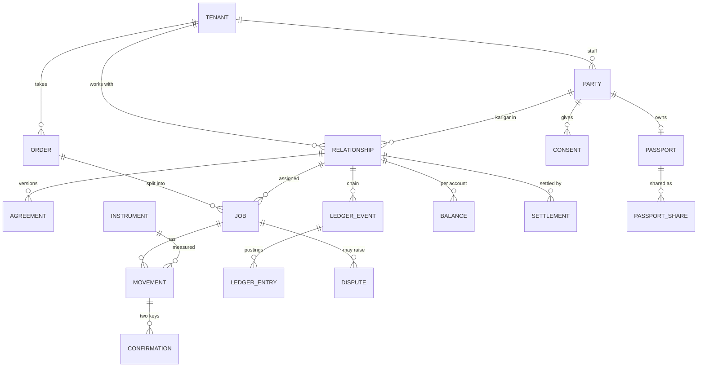
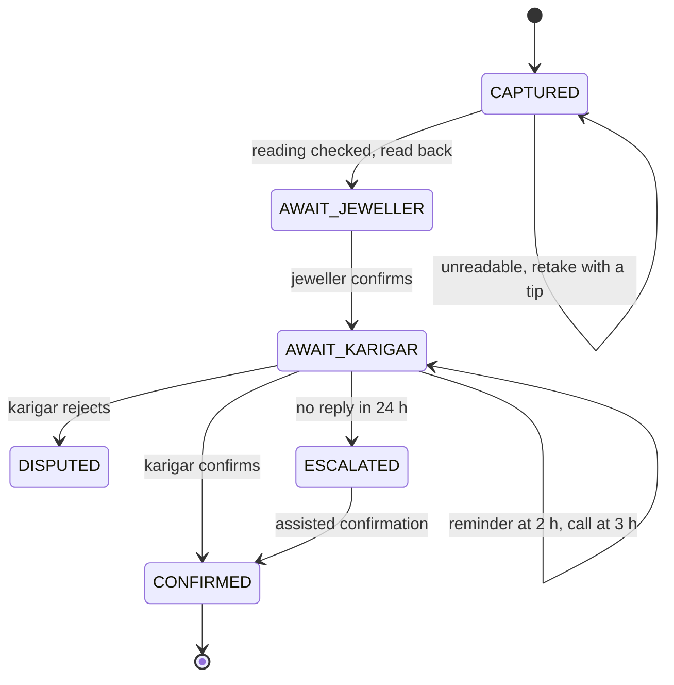
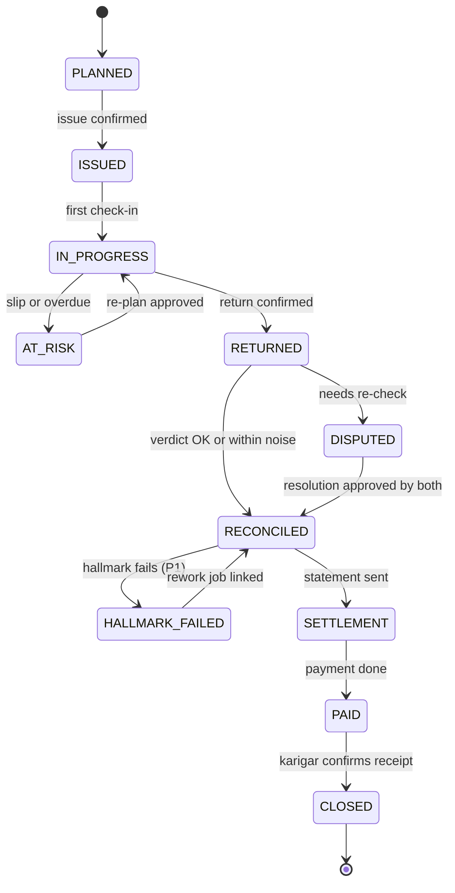

# Saakshi: low-level design

*Version 1, 11 Nov 2026 · Team FiatLux. Read the [high-level design](high-level-design.md) first. This document fixes the data, the maths, the state machines and the interfaces that the prototype is built to.*

**Priorities:** **P0** ships in the prototype · **P1** should ship · **P2** later.

---

## 1. Conventions
- **Anything that is counted is an integer:** weight in milligrams (mg), purity in parts per million (ppm; 916,000 ppm = 22K), money in paise. Floating-point values are rejected at the boundary.
- **Identifiers** are time-ordered UUIDs. Timestamps are stored in UTC and shown in IST.
- **Every write is idempotent** (keys in §7.5).
- **Every user-facing sentence comes from a reviewed message catalog** in the person's language (§8.5). Free text is rare and needs the jeweller's approval first.
- **Structured fields are validated against a schema on every write.**

## 2. Modules

| Module | Layer | Responsibility | In → out |
|---|---|---|---|
| `channels.whatsapp` | 1 | Webhook (signature check, de-duplication); sends templates, buttons, voice notes and media | Provider events → inbox rows; outbox rows → provider calls |
| `channels.calls` | 1 | Outbound call with a spoken or keypad reply (P1); a simulated call in P0 | Call request → reply audio or digits |
| `channels.simulator` | 1 | Two browser phones on the same engine path: the demo fallback and the test channel | Same as WhatsApp, with `provider = simulator` |
| `app` | 1 | Jeweller app screens and the offline capture queue | Captures → `POST /captures` |
| `console` | 1 | Case timeline, chain verifier, operator tasks, assisted confirmation, language gallery, demo clock | — |
| `inbox` | 1 → 3 | Turns inbound messages into domain events | Inbox row → `InboundAudio`, `InboundImage`, `InboundButton`, `InboundText`, `DeliveryStatus` |
| `voice` | 2 | Speech-to-text with language detection; text-to-speech; the number, unit and date verbaliser | Audio → transcript + English gloss; text → audio |
| `interpret` | 2 | Yes/no fast path; an LLM with a strict schema for everything else; clarification questions | Transcript → intent + details + confidence |
| `photo` | 2 | Vision-model scale-photo reader, purity reader, replay detection, fallbacks | Image → reading (mg or ppm) + checks |
| `engine` | 3 | Case router, pure handlers, executor, timers, outbox | Domain event → transition + actions |
| `agent` | 3 | The LLM reasoning loop for exceptions (§7.6): context builder, tool registry, loop runner, stop rules | Trigger + case → tool calls → proposals and messages |
| `planner` | 3 | Back-planning, karigar ranking, re-plan validation | Order + constraints → plan, ranked karigars, valid options |
| `reconcile` | 3 | Fine-gold maths, uncertainty, verdicts, noise rule, drift (P1) | Movements + agreement → result |
| `settle` | 3 | Statement maths and payment orchestration | Jobs + agreement → statement, payment request |
| `dispute` | 3 | Claims, evidence, neutral summary, options, resolution | Claims → options → resolution |
| `policy` | 4 | Approval gates, PIN checks, gold limits | Action + stored approvals → allow or deny |
| `ledger` | 5 | Posting rules, hash chain, balances, verification, corrections | Confirmed event → entries + new chain head |
| `vault` | × | Encryption of personal data, consent records, erasure | — |
| `catalog` | × | Message catalogs per language, with review status | Key + parameters + language → display text and speech form |
| `render` | × | Cards in every script, narrated video, voice notes, caching | Text + data → PNG, MP4, voice note |
| `partners` | × | UPI links, payout adapter, hallmarking adapter, lender verification | — |
| `models` | × | One model adapter over the LLM, speech and vision models; model set-ups and per-task routing (§7.7) | Task + input → output, usage and cost |
| `audit` | × | Append-only timeline of every event, decision, approval, timer and outside call | — |

## 3. Data design

### 3.1 Entities
Field types are logical (`uuid`, `int`, `text`, `bytes`, `time`, `struct`). `?` marks an optional field.

```text
-- parties and consent
tenant(id, name, settings, clock_offset_s, is_demo, created_at)                  -- one jeweller business
party(id, kind, tenant_id?, lang_primary, lang_secondary?, script_pref?, channel_pref, status, created_at)
      kind = jeweller_owner | staff | karigar | head_karigar | operator | customer
pii_vault(party_id, data_key_wrapped, phone_lookup_hmac UNIQUE, phone_enc, name_enc, upi_vpa_enc?, erased_at?)
consent(id, party_id, purpose, granted, notice_version, lang, evidence, granted_at, withdrawn_at?)

-- relationships and terms
relationship(id, tenant_id, karigar_id, status, gold_limit_mg, agreement_id?, chain_seq, chain_head)
             UNIQUE (tenant_id, karigar_id)
agreement(id, relationship_id, version, terms, status, proposed_by, signed_jeweller_at?, signed_karigar_at?)
      terms = { allowance:     item_class -> { pct_ppm, basis },
                                 basis = issued_fine | issued_gross | returned_fine | returned_gross
                making_charge: per_gram_paise | per_piece_paise,
                payment_terms, noise_rule = ignore | split | carry_forward }

-- orders and jobs
order(id, tenant_id, title, occasion_date, customer_id?, items, status, created_at)
job(id, order_id, tenant_id, relationship_id?, state, state_version, plan, created_at, updated_at)

-- instruments and movements
instrument(id, tenant_id, kind, make_model, readability_mg, accuracy_class, stamped_on?,
           sigma_mg?, sigma_ppm?, bias_ppm)                   -- kind = scale | xrf | touchstone | assay
movement(id, relationship_id, job_id?, kind, gross_mg, purity_ppm, purity_method, instrument_id?,
         sigma_mg, sigma_ppm, pieces?, media_ids, state, proposed_by, proposed_at,
         idempotency_key UNIQUE, corrects_id?)               -- kind = issue | return_piece | return_scrap | correction
confirmation(id, subject_type, subject_id, party_id, decision, channel, evidence, created_at)
             UNIQUE (subject_type, subject_id, party_id)      -- decision = confirm | reject

-- the ledger (append-only)
ledger_event(seq, relationship_id, rel_seq, type, payload, prev_hash, hash, occurred_at)
             UNIQUE (relationship_id, rel_seq)
ledger_entry(id, event_seq, relationship_id, unit, account, amount)   -- unit = fine_mg | paise
balance(relationship_id, unit, account, amount, as_of_seq)            -- KEY (relationship_id, unit, account)

-- money, approvals, disputes
settlement(id, relationship_id, job_ids, statement, total_paise, state, payout_ref?, paid_at?, confirmed_at?)
approval(id, tenant_id, action, subject_type, subject_id, requested_from, channel_required, state,
         expires_at, decided_at?, evidence)
dispute(id, subject_type, subject_id, opened_by, claims, options, resolution?, state, created_at, resolved_at?)

-- P1: hallmarking and passport
hallmark_submission(id, tenant_id, centre, source, items, state, created_at)
passport(id, karigar_id, claims, signature, issued_at, revoked_at?)
passport_share(id, passport_id, recipient, purpose, token UNIQUE, expires_at, consent_id, revoked_at?)

-- messaging, media and engine plumbing
media(id, owner_id, kind, mime, sha256, perceptual_hash?, bytes, path, provider_media_id?, lang?, created_at)
message_in(id, provider, provider_msg_id UNIQUE, party_id?, kind, payload, received_at, processed_at?, error?)
message_out(id, party_id, channel, template?, lang, params, media_ids, idempotency_key UNIQUE, state,
            provider_msg_id?, attempts, next_attempt_at, last_error?, created_at)
action_token(token, party_id, action, subject_type, subject_id, expires_at, used_at?)   -- button payloads
timer(id, tenant_id, case_type, case_id, kind, fire_at, payload, state)                  -- INDEX (state, fire_at)
case(id, case_type, subject_id, state, version, data, updated_at)
audit(id, ts, tenant_id, case_type, case_id, actor, kind, data)
```

### 3.2 Invariants (property-tested)
1. Every ledger event's entries sum to **zero** within each unit.
2. `balance` always equals a replay of `ledger_entry`.
3. A movement becomes `confirmed` only with two `confirm` rows, one from each party of its relationship.
4. Nothing in `ledger_event` changes after insert (database privileges plus a trigger).
5. Every gated action has an `approved` approval from the right party **before** it runs.

### 3.3 Relationships



## 4. Ledger

### 4.1 Posting rules (fine mg for gold, paise for money)

| Event | Entries |
|---|---|
| `IssueConfirmed` | custody **+f**, vault **−f** |
| `ReturnPieceConfirmed` | custody **−f**, finished **+f** |
| `ReturnScrapConfirmed` | custody **−f**, scrap **+f** |
| `AllowanceApplied` (at reconciliation) | custody **−a**, allowance **+a** |
| `VarianceRecognised` (b = the custody left over) | custody **−b**, variance **+b** |
| `GoldSettled` (the karigar returns gold to clear a shortfall, or is credited a surplus) | variance **−x**, vault **+x** (or the reverse) |
| `MakingChargeAccrued` | payable_to_karigar **+p**, jeweller_expense **−p** |
| `PaymentConfirmed` (the karigar confirmed receipt) | payable_to_karigar **−p**, cash **+p** |
| `Correction` | The exact reversal of the referenced event, plus new postings; needs both confirmations |
| Chained but not posted: `AgreementSigned`, `PlanApproved`, `ReplanApproved`, `SettlementApproved`, `DisputeResolved`, `HallmarkResultRecorded`, `LimitChanged` | — |

### 4.2 Hash chain (one per relationship)

```text
canonical(x) = UTF-8 JSON with sorted keys, no spaces, no floats
               (only integers, strings, booleans, null, lists and objects are allowed)
genesis      = SHA-256("saakshi:v1:" ‖ relationship_id)
body_n       = canonical({ rel, seq: n, type, at: ISO-8601 UTC, payload,
                           confirmations: sorted by party_id })
hash_n       = SHA-256(hash_(n−1) ‖ body_n)
chain_code   = "SKS-" + first 4 hex characters of hash_n, upper case       -- e.g. SKS-7F3A, on every receipt
```

- **Verification** (a console button, and `POST /ledger/{rel}/verify`) recomputes the chain from genesis and compares every stored hash, the head, and the last chain code each party received.
- **Demo:** a "tamper" button on a **copy** of a sandbox relationship shows the mismatch.

### 4.3 Corrections
- A row is never updated. A correction is a proposed `Correction` event that references the original `seq`.
- When both parties confirm it, the reversal and the new postings are appended.
- The receipts for both events stay visible to both parties.

## 5. Reconciliation (the fairness maths)

### 5.1 Algorithm

```text
fine(gross_mg, purity_ppm) = round_half_even(gross_mg × purity_ppm / 1,000,000)    -- exact decimal arithmetic

reconcile(issues, returns, rule, k = 2.5):
  fine_issued = Σ fine(m) over issues
  base        = the agreement's basis: issued_fine | issued_gross | returned_fine (pieces) | returned_gross (pieces)
  allowance   = round_half_even(base × rule.pct_ppm / 1,000,000)
  required    = fine_issued − allowance
  returned    = Σ fine(r) over returns (pieces and scrap)
  balance     = returned − required             -- mg; positive means the karigar returned more than required
  σ²          = Σ over every issue and return of
                  (purity_ppm / 10⁶ × σ_weight_mg)² + (gross_mg × σ_purity_ppm / 10⁶)²
  σ           = √σ²                              -- used to decide and to explain; never posted to the ledger
  verdict     = OK             if balance ≥ 0
                WITHIN_NOISE   if −k·σ ≤ balance < 0
                NEEDS_RECHECK  if balance < −k·σ
```

### 5.2 Default uncertainties (replaced by the instrument's own record when there is one)

| Measurement | Default σ |
|---|---|
| Weight on a stamped Class II scale (0.001 g readability) | 5 mg |
| Weight on an unknown or 0.01 g scale | 10 mg |
| Purity declared for the jeweller's own stock | 1,000 ppm (1 ‰) |
| Purity by XRF | 2,000 ppm (2 ‰) |
| Purity by touchstone | 10,000 ppm (10 ‰) |
| Purity by fire assay or a hallmarking centre | 300 ppm (0.3 ‰) |

### 5.3 Noise rule and re-test advice
- **Noise rule.** The agreement's `noise_rule` (`ignore`, `split` or `carry_forward`) decides a `WITHIN_NOISE` balance. Both parties signed it in advance.
- **`NEEDS_RECHECK`** opens a dispute, and **settlement is blocked** until it is resolved.
- **A re-test is recommended only** when its σ is clearly smaller than the current one **and** `|balance| × fine rate` is more than twice the re-test fee. Otherwise both parties hear: "A re-test can't settle this; the agreed rule applies."

### 5.4 Test vectors (these must pass)
Every case issues 48,250 mg at 916,000 ppm (σ 10 mg and 1,000 ppm) and returns scrap of 600 mg at 916,000 ppm. Unless stated, the allowance is 4% of issued fine, and returns are measured with σ 10 mg and 2,000 ppm (XRF).

| ID | Change | Fine issued | Allowance | Returned | Balance | σ | Verdict |
|---|---|---|---|---|---|---|---|
| T1 | Pieces 45,900 mg at 912,000 ppm | 44,197 | 1,768 | 42,411 | **−18** | 104.9 | **WITHIN_NOISE** |
| T2 | Pieces 45,500 mg at 912,000 ppm | 44,197 | 1,768 | 42,046 | **−383** | 104.2 | **NEEDS_RECHECK** (threshold −260.5) |
| T3 | Pieces 45,900 mg at 916,000 ppm | 44,197 | 1,768 | 42,594 | **+165** | 104.9 | **OK** |
| T4 | As T1, but the allowance is 4% of **returned gross** | 44,197 | 1,836 | 42,411 | **+50** | 104.9 | **OK**: the basis alone flips the outcome |
| T5 | As T1, but every purity by fire assay (σ 300 ppm) | 44,197 | 1,768 | 42,411 | **−18** | 25.5 | **WITHIN_NOISE** (threshold −63.7) |

### 5.5 Drift and instrument attribution (P1)
- **Per return:** `z = balance / σ`. **Per relationship:** a one-sided cumulative sum `S = max(0, S_prev − z − 0.5)`, with an **alarm when S > 4**.
- **Attribution.** For an instrument, take its last 8 or more jobs across 3 or more karigars.
  - If at least 60% of those karigars have a mean `z` below −0.5, the **instrument** is flagged to the jeweller with a calibration suggestion.
  - Otherwise a karigar-specific alert goes **privately** to both parties, with the evidence.

## 6. Planner, limits and settlement

### 6.1 Back-planning
```text
delivery         = occasion_date − 1 day
hallmark_window  = 2 days
polish           = 1 day
return_due       = delivery − hallmark_window − polish
issue_by         = return_due − making_time(item type, quantity)
check-ins        = at 40% and 80% of the span from issue to return_due
```
Durations per item type come from configuration, seeded from field interviews.

### 6.2 Karigar ranking
```text
score = 0.30 × skill_match
      + 0.20 × (1 − load_ratio)
      + 0.30 × on_time_rate          -- Beta-posterior mean, so a new karigar isn't punished for a short record
      + 0.15 × min(1, limit_headroom ÷ order_weight)
      − 0.05 × rework_rate
```
The jeweller sees the top three with plain reasons ("on time in 9 of 10 jobs", "has 120 g of headroom"). The weights are configurable.

### 6.3 Re-planning
- **Triggers:** a missed check-in, a reported slip, a decline, or the occasion date moving.
- **Option kinds:** `extend`, `split`, `reassign`, `expedite_hallmark`, `inform_customer`. Each comes with its date and gold implications.
- **Validation:** an option that breaks any date, capacity or buffer constraint is dropped before the jeweller sees it. If none is left, the safe default is `extend` or "ask the jeweller".
- **Approval:** the jeweller approves; a customer message needs its own approval.

### 6.4 Gold limits and tranches (P1)
- **Starting limit:** 150 g, configurable. (Field practice for a new karigar is 100–250 g.)
- **Adjustments,** always proposed to the jeweller for approval:
  - +25% after every 3 consecutive clean jobs (on time, and ✅ or 🟡);
  - −25% after a 🔴 resolved against the karigar.
- **Tranches** are suggested when the order weight is more than the headroom. The next tranche goes out when the previous one returns.
- **The karigar sees** their limit and what raises it.

### 6.5 Settlement maths
- **Making charge:** from the agreement, per gram of returned gross weight or per piece.
- **Gold balance by verdict:**
  - `OK` with a surplus: credited as fine gold, or converted at the day's rate, as the agreement says;
  - `WITHIN_NOISE`: the noise rule applies;
  - `NEEDS_RECHECK`: blocked.
- **Deductions:** only those written in the agreement.
- **GST:** shown at 5% "for information" only when the karigar is marked as registered.
- **Fine-gold rate:** entered by the jeweller each day; it defaults to the last value.

### 6.6 Payment
- **UPI intent link** (real, needs no licence): `upi://pay?pa=<vpa>&pn=<name>&am=<rupees>&cu=INR&tn=Saakshi%20<ref>`. It opens the jeweller's own UPI app. The jeweller then taps **Paid**, and the karigar is asked to confirm receipt.
- **Payout (sandbox):** through the payout adapter. A mock payout covers offline demos.
- **The payment runs only through the policy gate,** after both parties approved the statement and the jeweller entered a PIN.

## 7. Case engine

### 7.1 Parts
- **Clock:** `now(tenant)` = real time + `tenant.clock_offset_s`. Tests use a fake clock, and demo tenants can "skip three days" live.
- **Inbox:** turns messages into domain events.
- **Router:** maps an event to its case, by action token, by the pending question, or by subject ID.
- **Handlers:** pure functions (§7.2).
- **Executor:** applies a handler's actions **in one database transaction**.
- **Timers:** the scheduler wakes every second and takes due timers (`fire_at ≤ now(tenant)`), skipping rows another worker has locked.
- **Outbox sender:** retries with backoff of 1 s, 5 s, 30 s, 2 min and 10 min. After the sixth failure it emits `SendFailed`, which starts the fallback ladder.
- **Background jobs:** voice, photo reading, reply interpretation, rendering and payouts. Their results come back as events: `TranscriptReady`, `ReadingReady`, `Interpreted`, `MediaReady`, `PayoutResult`.

### 7.2 Handler contract
```text
handle(case_state, event, ctx) -> Transition(new_state, actions[])
    -- pure: no input or output; ctx gives read-only lookups and now()

action = SendMessage(intent, party, params, media?)        -- rendered from the catalogs
       | ScheduleTimer(kind, at, payload) | CancelTimers(kind)
       | RequestApproval(action, subject, party, channel, expires_at)
       | ProposeMovement(...) | AppendLedger(event_type, payload, confirmations)
       | StartJob(kind, input)                              -- voice, photo, interpret, render, payout
       | Audit(kind, data)
```

### 7.3 State machines

**Movement confirmation** (issue, return of pieces, return of scrap)



| State | Event | Guard | Actions | Next |
|---|---|---|---|---|
| CAPTURED | `ReadingReady` + `TranscriptReady` | Checks pass; cross-check passes | Read-back to the jeweller, with buttons | AWAIT_JEWELLER |
| CAPTURED | `ReadingReady` | Low confidence or a check fails | Ask for a retake, with a tip | CAPTURED |
| AWAIT_JEWELLER | Jeweller confirms | Within the gold limit (P1) | Render the receipt; template to the karigar; set timers `confirm_reminder`, `confirm_call`, `confirm_escalate` | AWAIT_KARIGAR |
| AWAIT_KARIGAR | Karigar confirms | — | Append `…Confirmed`; receipts with the chain code to both; cancel timers | CONFIRMED |
| AWAIT_KARIGAR | Karigar rejects | — | Open a dispute; tell the jeweller | DISPUTED |
| AWAIT_KARIGAR | `confirm_reminder` | — | Short reminder | AWAIT_KARIGAR |
| AWAIT_KARIGAR | `confirm_call` | — | Call (simulated in P0, real in P1) | AWAIT_KARIGAR |
| AWAIT_KARIGAR | `confirm_escalate` | — | Operator task and a jeweller alert | ESCALATED |

**Job**



**Settlement:** DRAFT → SENT (to both) → APPROVED_K / APPROVED_J → APPROVED_BOTH → PAY_REQUESTED (jeweller PIN) → PAYING → PAID → RECEIPT_CONFIRMED. On failure: PAY_FAILED, then a retry, or the UPI link is offered.

**Dispute:** OPEN (claims captured, summary prepared) → OPTIONS_SENT → RESOLUTION_PROPOSED → RESOLVED (both approve). The other exit is ESCALATED (a café operator or the association, offline).

**Onboarding and agreement:** INVITED → NOTICE_SENT → CONSENTED or DECLINED → TERMS_PROPOSED → TERMS_SIGNED (both) → ACTIVE.

### 7.4 Timers (defaults, configurable)

| Timer | Fires | Then |
|---|---|---|
| `confirm_reminder` | 2 h after the receipt was sent | A shorter reminder |
| `confirm_call` | 1 h later | A call (simulated in P0) |
| `confirm_escalate` | 24 h after the receipt | Operator task and a jeweller alert |
| `checkin_1`, `checkin_2` | At 40% and 80% of the job span | Check-in template |
| `due_reminder` | One day before the return is due | Reminder |
| `overdue` | 2 h after the return was due | Job goes AT_RISK; re-plan options |
| `approval_expiry` | 24 h | Ask again, then escalate |
| `settlement_nudge` | 24 h after the statement | Reminder |
| `payment_confirm` | 2 h after "Paid" | Ask the karigar to confirm receipt |

**Quiet hours** are 21:30–08:30 by default and set per person; messages are held until morning. Karigars often work late, so they can change this.

### 7.5 Concurrency and idempotency
- **Concurrency:** the case row is locked for the transition, and its `version` is checked.
- **Idempotency keys:** inbox → the provider's message ID; outbox → `idempotency_key`; captures → the app's client UUID; ledger → one event per movement confirmation; payouts → the settlement ID.

### 7.6 The agent loop
Routine events go straight to the pure handlers in §7.2. An event that needs judgement starts an agent run instead, in a background job:
- an `Interpreted` reply with `needs_clarification`;
- an `overdue` or `checkin` timer with a reported slip;
- a `dispute_claim`;
- silence after the fallback ladder.

The agent's results come back to the engine as ordinary actions, so the same executor, policy gate and audit apply.

```text
run_agent(case_id, trigger):
    ctx   = build_context(case_id, trigger)      -- see "Context" below
    steps = 0
    loop:
        out = models.complete(route="agent", context=ctx, tools=TOOLS)
        if out.stop in (refusal, max_tokens) or out.invalid: return fallback(case_id, trigger)
        if out.kind == "final":  return out.reply_or_nothing
        for call in out.tool_calls:                -- usually one
            validate(call, TOOLS[call.name].schema)  -- strict JSON schema; reject unknown fields
            result = policy.dispatch(call, case_id)  -- runs, creates a pending record, or asks for approval
            audit("agent.tool", call, result)
            ctx.append(observation(call, result))
        steps += 1
        if steps >= 6 or elapsed > 60 s: return fallback(case_id, trigger)
```

**Context**, ordered so that the stable part can be cached:
1. the system instructions and the tool definitions (byte-stable);
2. the jeweller's profile;
3. the case summary plus the last 20 events;
4. the trigger.

The event log is the authoritative memory. The summary is LLM-written, only saves tokens, and is never used as evidence.

**Tool contract.** Each tool has:
- a name;
- a JSON schema for its input;
- a class: read, talk, propose or gated (high-level design §4.4);
- an idempotency key derived from the case and the call.

`policy.dispatch` handles each class differently:
- **read:** returns data;
- **talk:** sends approved catalog templates only, never free text to a counterparty;
- **propose:** writes a pending record and returns its ID;
- **gated:** returns `approval_requested` until the stored approvals exist. It cannot be overridden from inside the loop.

**Stop rules:**
- at most 6 steps and 60 s per run;
- at most 3 runs per case per day before a person is asked in the console;
- a run never waits on a person. It stops, and the person's answer arrives later as a new event.

**Fallback:** the deterministic template path for that trigger. It asks a yes/no question or offers buttons, and a console task is opened.

### 7.7 Model adapter and routing
```text
models.complete(route, context, tools?, schema?) -> {kind, text?, tool_calls?, data?, stop, usage, cost}
models.transcribe(audio, lang_hint, vocab) -> {text, lang, confidence}
models.speak(text, lang, voice) -> audio
models.read_image(image, schema) -> {data, confidence}
```

**Set-ups** are named in configuration. Each says where a model runs and how it is reached:
- a **proprietary model** reached with an API key;
- an **India-built model** reached with an API key;
- an **open-weight model** served locally on the shop's or the association's computer.

**Routes** map a task to a set-up and its limits. The defaults below are changed in configuration only:

| Route | Task | Default set-up | Fallback |
|---|---|---|---|
| `extract` | A voice-note transcript → intent and details (schema) | A small, fast model | A stronger model |
| `vision` | A scale or purity photo → reading (schema) | A vision-capable model | A local vision model, then the seven-segment decoder |
| `agent` | Re-plans, clarifications, dispute drafts (tool loop) | The strongest available model | Deterministic template path |
| `stt`, `tts` | Speech in 22 languages + English | India-built speech models | Local speech models or recorded clips |

**Rules:**
- A route may change set-up only after the full scenario suite and the accuracy sets pass on the new one (§14.1).
- Usage and cost are logged per call and summed per case.
- A per-tenant budget switches the `agent` route to the fallback when it is exhausted.

## 8. Voice, replies and photos

### 8.1 Voice-to-text and language detection
- **Input:** a voice note (WhatsApp sends OGG/Opus), with the person's preferred language as a hint, or automatic detection on first contact.
- **Vocabulary hints:** up to 50 terms: the jeweller's karigar names, the karigar's jewellers, and item and trade words collected in the field.
- **Model:** a speech-recognition model on the `stt` route (§7.7).
- **Output:** the transcript in the speaker's language, plus an English gloss.
- **Language detection:** if detection confidence is below 0.6, run again without the hint. If a different language is detected with confidence ≥ 0.8 twice in a row, offer to switch (buttons).
- **Length:** notes up to 30 s are handled directly; longer ones (rare) are split at silences.

### 8.2 Reply interpreter
- **Yes/no fast path.** Word lists per language, matched on the transcript and its Latin transliteration after trimming fillers:
  - **yes:** hi *haan, ji, sahi, theek* · bn *hyan, thik* · ta *aamaa, sari* · te *avunu, sare* · kn *haudu, sari* · ml *athe, shari* · mr *ho, barobar* · gu *haa, barabar* · pa *haanji* · or *han* · ur *haan, ji* · as *hoi* · ne *ho, hajur* · en *yes, ok*;
  - **no:** *nahi, na, illa, illai, ledu, nako, no*.
  - Native reviewers extend the lists. Anything unmatched or mixed ("haan par…") goes to the interpreter.
- **Interpreter:** an LLM call on the `extract` route (§7.7) with a strict output schema.
- **Interpreter input:** the transcript and its English gloss; the person's role; the pending question (what we asked); the details we expect; known names.
- **Interpreter output (schema-validated):**
  - `intent`: confirm, reject, report_progress, report_delay, ask_balance, ask_payment, new_order, issue_details, return_details, dispute_claim, change_language, other;
  - `details`: karigar, item category, quantity, purity, target weight, due date, delay in days, claimed weight, note;
  - `confidence`, `needs_clarification`, `clarify_key`.
- **Rules:**
  - An invalid result gets one retry, then the pending question is asked again with buttons.
  - The interpreter never sets a weight (weights come from instruments) and never acts. Its result becomes a reply, or a proposal that is read back and confirmed.
  - **A buttons-only path always exists,** so understanding speech can never block a confirmation.

### 8.3 Scale-photo reader
1. **Privacy and replay:** strip the photo's metadata; compute a SHA-256 and a perceptual hash. A near-duplicate from the same jeweller within 30 days (Hamming distance ≤ 4) is a **replay** and is rejected with a reason.
2. **Normalise:** resize so the longest side is 1,280 px and auto-orient. The app's camera shows a guide box so the display fills the frame.
3. **Read and check:**
   - the unit is grams;
   - the decimals match the scale's readability;
   - 1 mg ≤ value ≤ 5,000 g;
   - the stability indicator is visible;
   - no zero or tare problem;
   - confidence ≥ 0.8.
4. **Cross-check** against a spoken weight, if there is one. If they differ by more than max(2 × readability, 20 mg), ask which is right.
5. **Read back** to the jeweller. On confirmation, the movement is proposed.

**Fallbacks, in order:** the vision model on the `vision` route → a local vision model → a seven-segment decoder (find the bright display region, threshold it, split it into digit cells, decode each segment pattern, place the decimal point) → keypad entry, typed twice.

**Test set:** at least 300 field photos from at least 10 scale models, split by scale model, so that the test photos come from scales never seen while tuning.

### 8.4 Purity reader
- A photo of the XRF screen or printout gives the fineness in ppm, which is read back.
- Typed or spoken entry is also allowed, with read-back.
- The method and the instrument are stored, because σ depends on them (§5.2).

### 8.5 Message catalogs and spoken output
- **Catalogs:** one file per language. Each key has a display text (cards, WhatsApp body), a speech form, and a review status (`draft`, `reviewed`, `native`).
  - English is the master. The other 22 languages are translated, then edited by native speakers.
  - **The build fails if a P0 key in a Tier A language is not native-reviewed.**
  - Live translation is used only for rare free text, such as a dispute summary, and only **after** the jeweller approves the English version.
- **P0 keys (about 60):** `consent.notice.*`, `agreement.readback.*`, `order.readback`, `plan.summary`, `receipt.issue|return.*`, `verdict.ok|noise|recheck.explain`, `checkin.*`, `replan.options.*`, `settlement.statement.*`, `payment.confirm`, `dispute.*`, `hisab.summary`, `escalation.*`, `error.retake.*`, `lang.switch.*`.
- **Spoken output** comes from a text-to-speech model on the `tts` route where the language has one. For the remaining languages it comes from a local speech model, or from **recorded clips**: every fixed phrase plus the number vocabulary (0–999, "thousand", "lakh", units, months) is prepared once per language and joined at runtime with 30 ms crossfades.
- **Caching:** all audio is cached by a hash of its content; fixed phrases are prepared at deploy time.

### 8.6 Languages and quality tiers

| Tier | Meaning | Languages |
|---|---|---|
| **A** | A native speaker reviewed every P0 key; tested with real users | Hindi, Bengali, Kannada, Tamil, English |
| **B** | One native reviewer; the voice checked by ear | Telugu, Malayalam, Marathi, Gujarati, Punjabi, Odia, Urdu |
| **C** | Translated catalog with a round-trip check; marked **beta** | Assamese, Nepali, Konkani, Maithili, Manipuri (Meitei), Bodo, Dogri, Santali, Sindhi, Sanskrit |
| **D** | Experimental | Kashmiri |

Language codes are stored as BCP-47 (`kn-IN`, `bn-IN`, `or-IN`, …) and mapped to each provider's codes in configuration.

### 8.7 Numbers, dates and scripts
- **Cards** use Latin digits by default (most people read them), with native digits as an option per person.
- **Speech:** digits are spoken with localised unit words (for example "48 গ্রাম 250 মিলিগ্রাম"), or as explicit number words from per-language tables (0–99, hundreds, thousands, lakh) where needed.
- **Dates and money** use localised month names and Indian digit grouping (₹12,34,567).
- **Scripts:** cards are rendered with full complex-script shaping (conjuncts, Nastaliq, Ol Chiki, Meetei Mayek), using the open Noto font family. The app loads only the font for the active language.

## 9. Channels

### 9.1 WhatsApp
- **Numbers:** a test number in the build weeks; a dedicated, verified business number for the pilot. **Opt-in is mandatory,** and the consent flow records it.
- **Webhook:**
  - `GET` verification with the challenge token;
  - `POST` with an `X-Hub-Signature-256` header = HMAC-SHA256(app secret, raw body). **Anything that fails is rejected.**
- **Inbound types:** text; audio (voice notes); image; template quick-reply button (carrying our action token); interactive button reply; delivery statuses (sent, delivered, read, failed).
- **Outbound:** templates (a video header with the narrated receipt, body parameters, quick-reply buttons carrying action tokens); inside the 24-hour window, interactive buttons (up to 3), voice notes, images and text.
- **Errors:** outside the 24-hour window only templates work, so the sender switches to a template; an undeliverable message starts the fallback ladder; rate limits get backoff.

### 9.2 Templates (category *utility*)

| Template | Header | Buttons | To |
|---|---|---|---|
| `saakshi_consent` | Video (narrated notice) | Agree · No · Replay | Everyone |
| `saakshi_terms` | Video (narrated terms) | Agree · No · Replay | Both |
| `saakshi_receipt` | Video (card + narration) | Confirm · Not correct · Replay | The counterparty |
| `saakshi_checkin` | Video or none | On track · Delayed · Call me | Karigar |
| `saakshi_statement` | Video (statement card + narration) | Approve · Not correct · Replay | Both |
| `saakshi_payment` | None | Received · Not received | Karigar |
| `saakshi_alert` | None | Open · Call | Jeweller |
| `saakshi_customer` | None | — | Customer (jeweller-approved) |
| `saakshi_login` | One-time code | Copy code | Jeweller and staff |

- **Languages:** each template is created in Hindi, Bengali, Tamil, Telugu, Kannada, Malayalam, Marathi, Gujarati, Punjabi, Urdu and English. For the other 12 languages a **universal** variant has short fixed text and emoji buttons (✅ ❌ 🔁), with **all the language-specific content in the video:** the card in the person's script plus the narration. Once the person replies, the 24-hour window is open and everything else goes in their language.
- **Copy rules:** no template body starts or ends with a variable or is mostly variables; no promotional wording. Templates are submitted in the first build week, and the simulator is the fallback while they await approval.

### 9.3 Action tokens (button payloads)
- A button's payload is a token of 16 random URL-safe characters that points to an `action_token` row (party, action, subject, expiry).
- Tokens are **single-use,** so a forwarded or old button can't confirm anything.

### 9.4 Calls
- **P0:** a browser "incoming call" plays the spoken question, records the reply, and sends it through voice-to-text. It is labelled **SIMULATED CALL**.
- **P1:** a real call gateway behind the same call-adapter interface, with a spoken or keypad reply.

### 9.5 Assisted confirmation
1. The operator plays the receipt to the person.
2. The person agrees.
3. The operator triggers a one-time code to the person's phone.
4. The person reads it out, and the operator enters it.
5. The confirmation is stored with `channel = assisted_otp` and the operator's ID.

Operator fees accrue in a mock fee ledger, so the jobs story can be shown.

### 9.6 Simulator
- Two phone frames in the browser (jeweller and karigar), connected over a live socket.
- It renders the same templates (video, body, buttons), records voice in the browser and uploads photos.
- It goes through **exactly the same engine path** (`provider = simulator` in `message_in`). It is the demo fallback and the test channel.

## 10. Rendering and media
- **Cards:** 720 × 960 PNG, 150 KB or less. Big digits, an item icon, both parties' names, the due date, the chain code and a status colour (green ✅, amber 🟡, red 🔴). A **MOCK** or **SANDBOX** ribbon where relevant.
- **Narrated video** for template headers: the card plus the narration, 10–15 s and under 1 MB (WhatsApp allows 16 MB).
- **Voice notes** inside the 24-hour window: OGG/Opus mono, so they play as normal voice notes.
- **Caching:** by content hash. Each WhatsApp media ID is reused for 25 days. Outgoing media is uploaded while the jeweller is still confirming, which hides the latency.

## 11. Interfaces

### 11.1 HTTP endpoints (JSON; session cookie for the app and the console)
- **Webhooks and simulator:** `GET`/`POST /webhooks/whatsapp` · `WS /sim/ws` · `POST /sim/inbound` · `GET /sim/call/{id}`
- **Auth:** `POST /auth/otp/request` · `POST /auth/otp/verify` · `POST /auth/pin/set` · `GET /me`
- **Karigars and agreements:** `GET /karigars` · `POST /karigars` (invite) · `GET /karigars/{id}` · `POST /relationships/{id}/agreements` · `GET /relationships/{id}/agreements`
- **Orders and jobs:** `POST /orders` · `GET /orders/{id}` · `GET /jobs?state=` · `GET /jobs/{id}` · `POST /jobs/{id}/plan/approve` · `POST /jobs/{id}/replan/{option}/approve`
- **Captures and movements:** `POST /captures` (photo or audio + `client_uuid`) · `GET /captures/{id}` · `POST /movements/{id}/confirm` · `GET /jobs/{id}/reconciliation`
- **Settlements:** `POST /jobs/{id}/settlement` · `POST /settlements/{id}/approve` (needs the PIN) · `GET /settlements/{id}/upi-link` · `POST /settlements/{id}/mark-paid`
- **Approvals and disputes:** `GET /approvals?state=pending` · `POST /approvals/{id}/decide` · `GET /disputes/{id}` · `POST /disputes/{id}/resolution`
- **Passport (P1):** `POST /passports` · `POST /passports/{id}/share` · `GET /p/{token}` (public verification)
- **Hallmarking and mocks (P1):** `POST /hallmark/submissions` · `POST /mock/ahc/submit` · `POST /mock/lender/offer`
- **Console:** `GET /cases/{type}/{id}/timeline` · `POST /ledger/{rel}/verify` · `POST /demo/clock/advance?hours=` · `POST /demo/reset` (demo tenants only)
- **Media:** `GET /media/{id}?exp=&sig=` (HMAC-signed, expires in 10 minutes)

### 11.2 Domain events
- **Inbound:** `InboundAudio`, `InboundImage`, `InboundButton`, `InboundText`, `DeliveryStatus`
- **Background results:** `TranscriptReady`, `ReadingReady`, `Interpreted`, `MediaReady`, `PayoutResult`
- **Engine:** `TimerFired`, `SendFailed`, `ApprovalDecided`
- **Ledger:** the event types in §4.1

## 12. Security and privacy
1. **Vault.** Personal data is encrypted with AES-256-GCM, using a data key per person that is wrapped by a master key held outside the database. Phone lookups use an HMAC, so the phone number itself is never a search key.
2. **Erasure** destroys the person's data key. The ledger holds only pseudonymous IDs, so it stays verifiable. Records required by law (for example for tax) are kept as required.
3. **Authentication.** Jewellers and staff log in with a one-time code on WhatsApp and get a session cookie (`HttpOnly`, `Secure`, `SameSite=Lax`, 30 days). **A PIN is needed for every money action.** Console admins use a password plus TOTP.
4. **Authorisation.** Every query is checked by tenant and by relationship. A karigar sees only their own relationships.
5. **Integrity.** Webhook signatures checked; single-use action tokens; signed media links; idempotency everywhere.
6. **Database privileges.** The application's database account cannot update or delete ledger rows, confirmations or the audit trail.
7. **Input hygiene.** Everything people send is treated as data, never as instructions. Outside services get pseudonymous IDs and never phone numbers. Every structured result is schema-validated, and the test suite includes injection attempts.
8. **Logs.** Personal data is redacted. Debug capture is opt-in, for demo tenants only.
9. **Rate limits** per IP address and per party, with alerts on bursts.
10. **Secrets** live only in environment variables, never in the repository, and the repository is scanned for secrets in continuous integration.
11. **Data protection (DPDP) basics:**
    - a notice in the person's language (voice + card);
    - consent per purpose: `core_service`, `voice_recording`, `product_testing`, `passport_share`, `customer_updates`;
    - withdrawal by voice ("consent band karo");
    - retention defaults: raw audio 30 days, photos 180 days, the ledger as long as the law requires.

## 13. Passport and hallmark linkage (P1)
- **Passport credential:** a signed credential (Ed25519 over the canonical JSON) with:
  - the period and the number of jobs;
  - grams handled, in bands;
  - on-time %;
  - the share of returns within the agreement;
  - disputes, open and resolved;
  - the number of jewellers;
  - optional co-attestations by jewellers.
- **Sharing:** voice request → purpose, recipient and expiry read back → consent → share token → public verification page `/p/{token}` (validity and claims only) → revocable at any time.
- **Mock lender:** applies a public scheme's checklist and returns an indicative offer, labelled **MOCK**.
- **Hallmark linkage:** a hallmarking result (mocked in the prototype) is linked to the HUID, the job and the return purity. A failure produces an evidence pack and a rework or cost-split proposal that both parties approve.

## 14. Testing

### 14.1 Layers

| Layer | What | Gate |
|---|---|---|
| Unit | Maths, verbaliser, routing, adapters (with outside services mocked) | Every push |
| Property | Ledger invariants (§3.2), reconciliation monotonicity, idempotent replays | Every push |
| Scenario | 32 end-to-end scenarios through the simulator, with the fake clock and recorded voice fixtures | Every push |
| Accuracy | Reply understanding on field voice notes; scale reading on field photos; purity reading; re-plan feasibility | End of each sprint |
| Model and provider conformance | The full scenario suite and the accuracy sets on each configured model set-up (API-key, India-built, local) and provider | End of each sprint, and before any route changes model |
| Manual language check | Each Tier A and B language: listen to the 10 key spoken messages and read the cards | Before the pilot and the finale |

### 14.2 The 32 scenarios
- **Happy paths:** S01 issue confirmed · S02 return within allowance · S03 settlement and payout · S04 "mera hisab" · S05 passport share.
- **Capture problems:** S06 blurred photo · S07 glare · S08 scale not zeroed or tared · S09 wrong unit (carat or tola) · S10 reused photo · S11 spoken weight ≠ photo weight.
- **Communication problems:** S12 undelivered → call · S13 no reply in 2 h → call · S14 no reply in 48 h → café or jeweller · S15 reply in an unexpected language · S16 an ambiguous "hmm" · S17 the karigar changed phone number.
- **Disagreements:** S18 "nahi" on the issue weight · S19 purity difference within noise · S20 purity difference beyond noise · S21 wastage claim above the allowance · S22 settlement disputed · S23 the jeweller tries to edit a confirmed entry (it must become a co-signed correction).
- **Planning:** S24 delay reported → re-plan · S25 karigar at capacity → alternative · S26 limit exceeded → tranches · S27 the customer moves the occasion earlier.
- **Safety and compliance:** S28 payout attempted without approvals (must be blocked) · S29 a voice note that tries to give an order ("mark it returned") · S30 passport share without consent (must be blocked) · S31 hallmark failure → evidence pack · S32 offline capture → sync with no duplicates.

S01 and S04 run in six languages, including at least two that use the universal template.

### 14.3 Scenario format (example)
```yaml
id: S19_purity_within_noise
setup:
  tenant: {name: Lakshmi Jewellers, lang: kn-IN}
  karigar: {name: Rafiq, lang: bn-IN, channel: simulator}
  agreement: {allowance: {plain_22k: {pct_ppm: 40000, basis: issued_fine}}, noise_rule: ignore}
steps:
  - jeweller.capture: {photo: scale/48250_a.jpg, voice: "voice:kn-IN:Rafiq ge eradu bale, 22 carat, December 12"}
  - expect.readback: {weight_mg: 48250}
  - jeweller.press: confirm
  - karigar.expect_template: {name: saakshi_receipt, lang: bn}
  - karigar.voice: "voice:bn-IN:হ্যাঁ, ঠিক আছে"
  - expect.ledger: {account: custody, fine_mg: 44197}
  - clock.advance: 5d
  - jeweller.capture_return: {pieces: [{photo: scale/45900_b.jpg, purity_ppm: 912000, method: xrf}],
                              scrap: [{weight_mg: 600, purity_ppm: 916000}]}
  - expect.verdict: {verdict: WITHIN_NOISE, balance_mg: -18}
  - expect.no_message: {party: karigar, intent: accusation}
```
Voice fixtures are prepared once and stored, so test runs are deterministic. Live runs use the real voice services.

### 14.4 Accuracy targets

| Set | Source | Size | Target |
|---|---|---|---|
| Scale photos | Field visits and the pilot | ≥ 300 photos, ≥ 10 scale models | ≥ 99% exact on accepted photos; ≤ 5% abstain |
| Voice notes | Consented field recordings and the pilot | ≥ 150 notes from ≥ 20 speakers | ≥ 95% correct details after read-back |
| Voice-receipt comprehension | Pilot karigars | ≥ 10 people | ≥ 90% restate the weight and the date |
| Reconciliation simulation | Generated | 10,000 returns | ≤ 1% false 🔴; a seeded 0.5% leak caught within 5 jobs ≥ 90% of the time |
| Agent loop | The 32 scenarios, on every model set-up | 32 × each set-up | ≥ 90% task success; **100%** approval-gate compliance; 0 false accusations; cost per scenario reported |

### 14.5 Continuous integration
- **On every push:** lint → type checks → unit and property tests → the scenario suite → the app build.
- **A manual accuracy workflow** (with secrets) runs the accuracy sets and the provider conformance suite and publishes reports. It refuses to run if its estimated cost exceeds a set budget.

## 15. Deployment and configuration
- **Processes:** an API service (stateless: webhooks, app and console endpoints, simulator socket, signed media); workers (inbox, engine, timers, outbox, background jobs; row locks make several replicas safe); one relational database (the only stateful store); an encrypted media store; optional local AI models (an open-weight LLM, speech and vision); an HTTPS entry point for webhooks.
- **Configuration:** each adapter (messaging, calls, payments, partners) and each model route (§7.7) is chosen by configuration, with no code change. Secrets come from environment variables. An example configuration file with no secrets is committed.
- **Environments:** demo tenants with the virtual clock and a reset button; pilot tenants with real numbers and real people.
- **Real versus simulated in the prototype:** WhatsApp messaging, voice, the ledger, the maths, the engine, UPI intent links, the app and the console are **real**. Payouts (sandbox), hallmarking results, the lender and insurer, calls in P0, SMS and GST filing (documents only) are **sandbox or mock**, and labelled as such everywhere.
